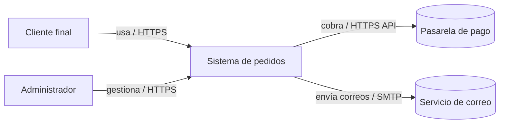
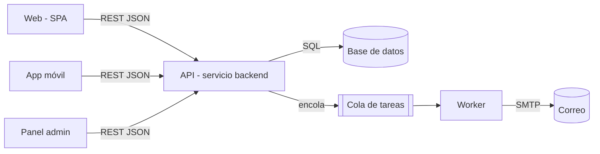
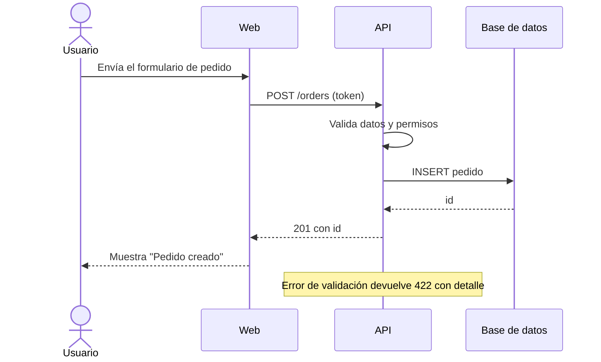
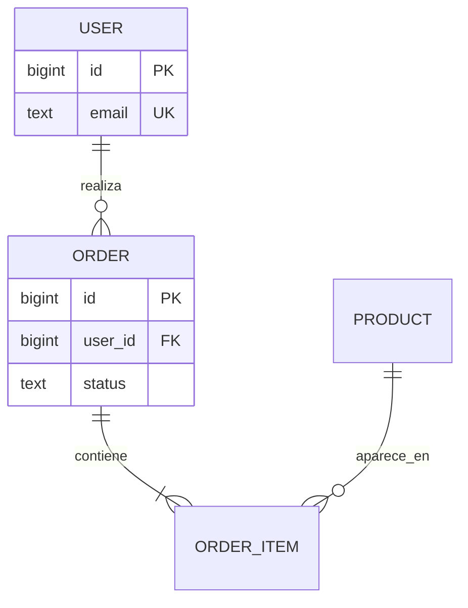
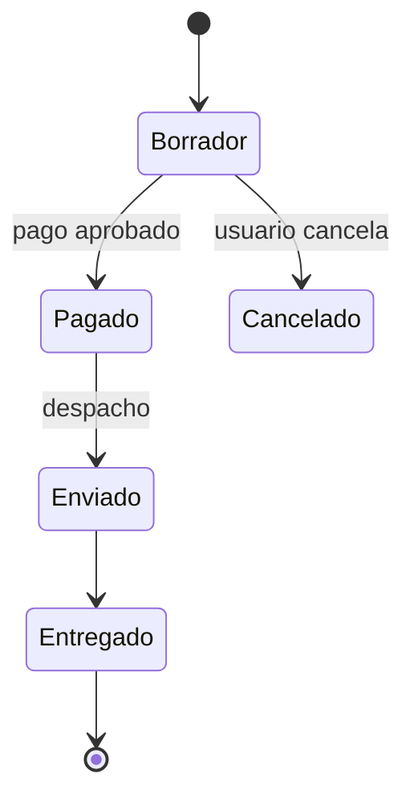
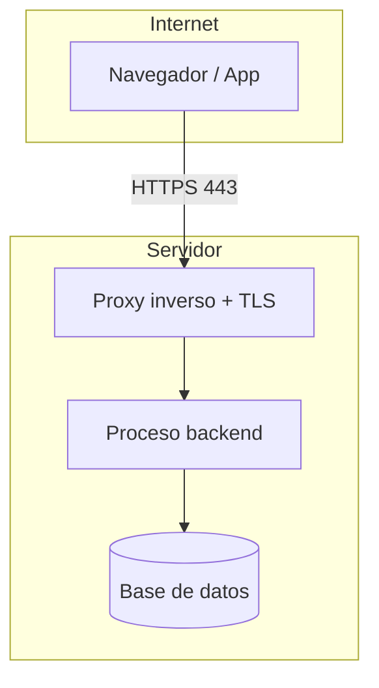
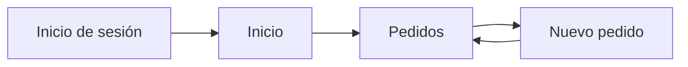

# Diagramas (Mermaid)

Los diagramas son texto versionado junto al documento: fuente en `docs/diagrams/src/*.mmd` y bloque Mermaid incrustado. GitHub y GitLab lo renderizan de forma nativa.

## Qué diagrama para qué pregunta

| Pregunta | Tipo |
|---|---|
| ¿Qué sistemas hablan con cuáles? | `flowchart` (contexto / contenedores) |
| ¿Cómo se ejecuta este caso de uso? | `sequenceDiagram` |
| ¿Cómo son los datos? | `erDiagram` |
| ¿Qué estados tiene un pedido? | `stateDiagram-v2` |
| ¿Cuál es el proceso de negocio? | `flowchart` |
| ¿Cómo se despliega? | `flowchart` con `subgraph` |
| ¿Cómo navega el usuario? | `flowchart` de pantallas |

## Reglas

- [ ] Una idea por diagrama; máximo 6-8 elementos y ~6 relaciones. Si crece, divide.
- [ ] Título y, si hace falta, leyenda. Flechas con verbo y protocolo.
- [ ] Nombres **idénticos** a los del código (módulos, tablas, rutas).
- [ ] Verifica que renderiza: un token inválido rompe el bloque sin avisar. Comprueba en el visor del repo o con el CLI de Mermaid (**verificar en el entorno**).
- [ ] Sin datos sensibles: nada de IPs, hosts internos reales, nombres de clientes, llaves.
- [ ] No dibujes lo que no verificaste; si es hipótesis, rotula "(inferido)".
- [ ] Nivel C4 1 y 2 siempre; 3 solo si aporta; 4 nunca a mano.

## Ejemplos mínimos

### Contexto (C4 nivel 1)

### Contenedores (C4 nivel 2)

### Secuencia de un flujo clave

### Modelo de datos (ER)

### Estados

### Despliegue

### Navegación de pantallas (manual)

## Mantenimiento

- Un cambio de rutas, tablas o módulos obliga a revisar el diagrama que los nombra.
- PlantUML solo si hace falta algo que Mermaid no da (C4 completo); exige render en CI y guarda también el SVG exportado (**verificar en el entorno**).
- Si el documento se exporta a PDF o DOCX, exporta antes los diagramas a imagen y comprueba que quedaron legibles.
